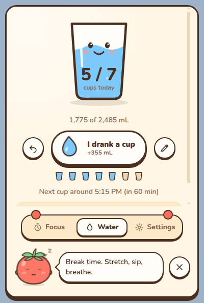
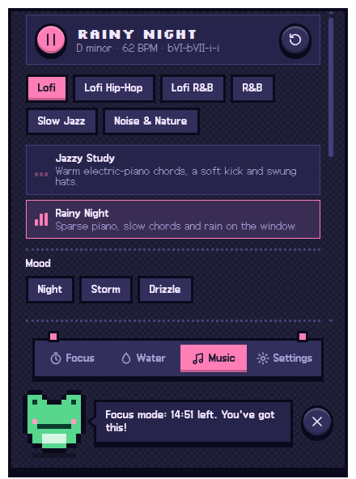
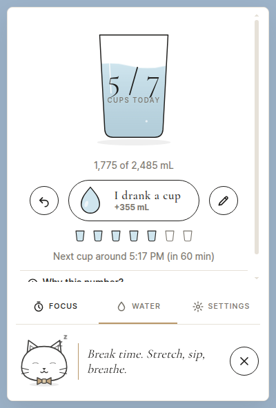

# Horologium

A cute floating desktop buddy for **focus, hydration and lofi music**: a Pomodoro timer, a water reminder that counts in *cups* and sets its pace from your body and activity, and a music player. A little character sits on top of your screen, pops in and out with a hotkey, and expands into animated menus.

<p align="center">
  
  
  
</p>

> ## This project is entirely vibe coded
>
> Every line was written by an AI agent (Claude) while the owner steered in plain language. There is no hand-written code to lean on, so:
>
> - **Verify before you trust it.** Tests are the source of truth. [`AGENTS.md`](AGENTS.md) lists exactly what is verified and what is **not**.
> - **Expect rough edges.** It works the way the tests and the owner's eyes say it works, not the way a seasoned team would have hardened it. No warranty (see [LICENSE](LICENSE)).
> - **That is also the invitation.** [`AGENTS.md`](AGENTS.md) is the project's shared memory: what each piece is, *why* every decision was made, what was rejected, the hard rules, and recipes for adding things. It exists so that **you can clone this repo, point your own coding agent at it, and add your ideas** with full context.
>
> ### Contribute with your agent
> 1. `git clone` the repo and open it in your agent of choice (Claude Code reads `CLAUDE.md`, which points at `AGENTS.md`; other agents read `AGENTS.md` directly).
> 2. Tell it your idea ("add a bossa station", "add a Japanese translation", "add a forest theme").
> 3. Most ideas are **drop-in folders** (themes, characters, languages, music stations, music packs), so the agent should use `npm run new -- ...` and [`docs/extension-api.md`](docs/extension-api.md), not edit core code.
> 4. Run `npm test` and `npm run validate`.
> 5. Add a dated entry to the **Decision log** in `AGENTS.md` (what and why), update "Verification status" honestly, and open a PR.

## What it does

- **Floating widget.** Transparent, frameless, always on top, draggable (it remembers where you left it). Press **Ctrl/Cmd + Shift + 1** (rebindable) and the character pops onto the screen; press it again and it pops away. A tray icon is the fallback. Click the character to expand it; it holds the menu tabs.
- **Pomodoro.** Focus / short break / long break (25 / 5 / 15 by default, long break every 4 sessions, all editable), start / pause / reset / skip, chimes, an optional auto-start. It runs on absolute timestamps, so sleep and throttling never make it drift.
- **Hydration.** Log a cup with the big water-drop button (a splash, a filling glass, milestone confetti at 25 / 50 / 75 / 100 %). Misclicked? **Undo**. Your daily target comes from your height, weight, age, sex, exercise and the local weather (see [the model](#the-hydration-model)). Reminders wait for your next Pomodoro break instead of interrupting a focus session.
- **Music**, in sub-tabs:
  - **Stations**: built-in generated music, nothing to download or license. *Lofi* (Jazzy Study, Rainy Night), *Lofi Hip-Hop*, *Lofi R&B*, *R&B*, *Slow Jazz* (Late Night Trio, Smoky Ballad) and *Noise & Nature* (white, pink and brown noise, steady rain). Every station has moods, its own sliders and layer mixes (rain, vinyl crackle, noise). Optionally the music follows your Pomodoro.
  - **My music**: play audio files from folders you pick, plus *music packs* (for example AI-generated tracks you made elsewhere).
  - **YouTube**, **Spotify**, **Melon**: the services' own websites in a view that is only created while its tab is open (it costs nothing otherwise). The YouTube tab grows so you can browse and search youtube.com (YouTube Music is there too, but it can be Premium-only in some regions, for example South Korea); when you collapse the widget a playing video is **pinned** into a tiny always-on-top mini player that fades to a dim state after 3 s and lights up when you hover it or press the hotkey. Spotify and Melon load, but this build has no DRM module (Widevine), so full tracks may not play there; each tab says so and has an *Open in browser* button.
- **Three themes**, each with three characters: **Sprout Garden** (cream, sticker outlines, a tomato that ripens as you focus), **Pixel Lofi** (a night-window study room in pixel art), **Seoul Jazz White** (all-white, hairlines, a champagne accent, slow and elegant). **English and Korean** UI.
- **Settings**: theme, character, **character size**, **volumes** (master, chimes, music), mute, the global show/hide **hotkey** (a key recorder that warns about risky combinations), Pomodoro and hydration settings, language, launch at login, reduce motion.

### Keys

| Where | Key |
|---|---|
| Anywhere | **Ctrl/Cmd + Shift + 1**: show / hide the widget (change it in Settings) |
| Widget focused | **1-4** switch tab, **Space** start/pause the Pomodoro, **D** log a cup, **Z** undo, **Esc** collapse (or hide) |
| Mini player | hover, or the show/hide hotkey, brings it to full opacity |

## Install

> **Unsigned builds.** There is no paid code-signing certificate behind these installers, so the first launch shows an OS warning. That is expected; it does not mean the file is damaged.

### Option 1: an installer

Installer builds are configured with electron-builder: `npm run dist` builds one for the OS you run it on (the Linux AppImage and deb were built and the AppImage launched; Windows and macOS were never built). A GitHub Actions workflow that would build all three on a version tag and attach them to a draft release is written but is **not in the repository yet**, so there is no download on the [Releases page](https://github.com/skyachieved/Horologium/releases) for now: use option 2, or `npm run dist`.

| OS | File | First launch |
|---|---|---|
| Windows | `Horologium-<version>-win-x64.exe` (per-user, no admin) | SmartScreen: **More info > Run anyway** |
| macOS | `Horologium-<version>-mac-arm64.dmg` / `-x64.dmg` | Right-click the app > **Open**. If macOS says it is "damaged": `xattr -dr com.apple.quarantine /Applications/Horologium.app` |
| Linux | `Horologium-<version>-linux-x86_64.AppImage` or `Horologium-<version>-linux-amd64.deb` | `chmod +x` the AppImage and run it (some distros need `libfuse2`). On Ubuntu 24.04+ an AppArmor rule can block Electron's sandbox: run with `--no-sandbox`, or allow user namespaces |

### Option 2: clone and run

You need [Node.js](https://nodejs.org) 20 or newer (no other tools).

```bash
git clone https://github.com/skyachieved/Horologium.git
cd Horologium
npm install
npm start        # the first start downloads the Electron runtime (about 100 MB), so it takes a minute
```

Run the tests (plain Node, no install needed): `npm test`. Build an installer for your own OS: `npm run dist` (output in `dist/`).

## The hydration model

Your daily target is built from things that actually change how much you need:

1. **Total body water** from the Watson formula, which uses your **height, weight, age, and sex**.
2. Baseline drinking fluid = body water x 0.072, calibrated so a typical 70 kg man lands near 3.0 L and a typical 60 kg woman near 2.2 L, matching the US National Academies adequate intakes for beverages.
3. **Exercise**: intensity (light / moderate / vigorous) x minutes, estimating the sweat you need to replace (300 / 500 / 800 mL per hour, capped at 1.5 L).
4. **Climate**: your local temperature and humidity from [Open-Meteo](https://open-meteo.com) (free, no key), +250 mL when warm, +500 mL when hot or hot-and-humid.
5. The total is clamped to 1.2-4.5 L, converted to **whole cups of your own cup size** (small 250 mL, medium 355 mL, large 500 mL, or custom), and reminders are paced across your day: the gap between cups adapts to how far behind or ahead you are (15-120 minutes). During a focus session, reminders wait for your next break.

This is general wellness guidance, **not medical advice**. If you have a condition that affects fluid intake (kidney or heart conditions, for example), follow your clinician's advice.

## Music and legal notes

- **Stations** are generated on your machine (a seeded composer plus a Web Audio synthesizer, instrumental only), so there is nothing to license. The AI agent that wrote them cannot listen: loudness, clipping and structure are measured automatically, but whether they sound good is your call. Tweak a station in its folder (it is mostly JSON) or tell your agent.
- **My music** plays files you provide. Music packs may declare a license and provenance; without both they are labelled "unverified license". The repository ships no audio.
- **YouTube, Spotify, Melon** tabs show those services' own websites with **your own account**. Horologium is unofficial and not affiliated with them. It deliberately does **not** block ads, download or cache audio, scrape, automate, inject scripts, or spoof the browser, and it will not work around Google blocking sign-in inside embedded views (see the hard rules in [`AGENTS.md`](AGENTS.md)). Playback and sign-in limits are listed there under *Known limitations*.

## Performance

Measured on the packaged Linux build under WSL2 with **software rendering** (no GPU), which is a pessimistic setup; Windows and macOS are **not measured**:

| State | CPU (one core) | Memory (PSS, all processes) |
|---|---|---|
| Collapsed, idle | about 1% | about 250 MB |
| Expanded, left alone for 20 s | about 0.3% | about 255 MB |
| A station playing (window hidden) | about 7% (rendering the next phrase) | about 295 MB, flat over the 8 minutes measured |
| YouTube tab open | not re-measured; earlier run: +350 MB, 2 extra processes, freed when the tab closes | |

An idle widget pauses all of its animations ("calm mode"): without it the character's idle animation alone cost about 3.8% of a core. Web tabs cost nothing until you open them.

## Privacy

No accounts and no analytics. The only network calls are weather lookups (your city, or approximate coordinates if you press the optional "use approximate location" button, go to Open-Meteo and ipwho.is) and any music web tabs you choose to open. Your settings and history stay in your user-data folder.

## Extending it

Themes, characters, languages, music sources, genres, stations, sound layers, instruments, chord banks, grooves and music packs are **drop-in folders** with strict manifests; a broken one is skipped with a reason shown in Settings, never a crash.

```bash
npm run new -- station sunday-bossa --category lofi        # a station (JSON only)
npm run new -- station my-vibe --user                       # a personal station in your own folder
npm run new -- theme forest --name "Forest" --ko "숲"
npm run new -- character fox --theme forest
npm run new -- locale fr --name "Français"
npm run validate                                            # load everything exactly like the app does
npm run test:audio -- --calibrate                           # match a new station's loudness
npm run render -- jazzy-study                               # write a station to a WAV so you can listen outside the app
```

Field reference: [`docs/extension-api.md`](docs/extension-api.md). Why things are the way they are: [`AGENTS.md`](AGENTS.md).

## Credits

- Weather data by [Open-Meteo.com](https://open-meteo.com) (CC BY 4.0).
- Fonts bundled under the SIL Open Font License: Nunito, Galmuri11, Silkscreen, Cormorant Garamond and Pretendard (the license texts sit next to the font files in `extensions/themes/*/fonts/` and `src/renderer/fonts/`).

## License

MIT, see [LICENSE](LICENSE).
